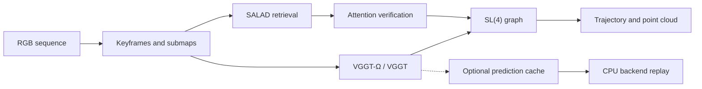

# VGGT-Ω-SLAM

**Monocular visual SLAM with VGGT-Ω geometry, loop closure, and SL(4) graph optimization.**

[](https://github.com/KaiFeng-Frank/VGGT-Omega-SLAM/actions/workflows/cpu-tests.yml)

An independent integration of [VGGT-Ω](https://github.com/facebookresearch/vggt-omega) into [VGGT-SLAM 2.0](https://github.com/MIT-SPARK/VGGT-SLAM). Run a timestamped RGB sequence to produce a camera trajectory and point cloud, switch between Ω and VGGT, and replay cached predictions to study backend choices without rerunning the network.

中文：将 **VGGT-Ω 接入完整的单目 SLAM 流程**，覆盖关键帧、子图、回环检测、图优化与轨迹/点云导出，并提供 VGGT 对照、CPU 后端重放和可复现实验。

[Installation](docs/INSTALL.md) · [Quick start](#quick-start) · [System adaptation](docs/ADAPTATION.md) · [Reproduction](docs/REPRODUCE.md) · [Results](docs/RESULTS.md)

## Features

| Component | What this repository provides |
|---|---|
| **Ω frontend** | Official balanced preprocessing for the 512 checkpoint, official camera decoding, and the model's native precision policy. |
| **Loop closure** | SALAD candidate retrieval and Ω-specific attention verification with a separately calibrated configuration. |
| **SLAM pipeline** | Optical-flow keyframes, overlapping submaps, SL(4) graph optimization, and trajectory/point-cloud export through a headless runner. |
| **Backend experiments** | Optional confidence selection, graph-noise and Huber policies; lossless prediction caches and CPU replay. |
| **Memory management** | A shared GPU lock, configurable memory reserve, and optional CPU storage for historical keyframe images. |
| **Reproducibility** | Pinned upstream sources, checkpoint identities, frame manifests, run metadata, corrected geometry metrics, and published experiment records. |

The Ω adapter handles preprocessing, camera representation, precision, and attention-based loop verification in [vos/omega_backend.py](vos/omega_backend.py). The original VGGT frontend remains available for comparisons through the same runner.

## Pipeline



The runner uses RGB images. Ground truth, when available, is used for final evaluation. Trajectories and point clouds retain monocular scale; TUM evaluation reports Sim(3)-aligned ATE.

## Quick start

**Environment:** Linux, Python 3.11, an NVIDIA CUDA GPU, and GTSAM with SL(4) Python bindings. The supported Ω checkpoint is **VGGT-Ω-1B-512**. CPU tests, preflight, and cached backend replay are available separately from CUDA inference.

```bash
git clone https://github.com/KaiFeng-Frank/VGGT-Omega-SLAM.git
cd VGGT-Omega-SLAM
```

Follow the [installation guide](docs/INSTALL.md) to create the environment, fetch pinned sources, obtain checkpoints, and set their `VOS_*` paths. Then check the runtime and run a sequence:

```bash
python run_slam.py --preflight-only

python run_slam.py data/tum_rgbd/rgbd_dataset_freiburg1_desk \
  --backend omega \
  --submap-size 16 --min-disparity 50 --max-loops 1 --seed 0 \
  --output runs/desk_omega
```

The input can be a TUM sequence directory or an image directory with timestamped filenames. Use a **new output directory** for each run. A TUM sequence's `groundtruth.txt` is detected automatically.

For the VGGT comparison, install its checkpoint as described in the guide and run:

```bash
python run_slam.py data/tum_rgbd/rgbd_dataset_freiburg1_desk \
  --backend vggt \
  --submap-size 16 --min-disparity 50 --max-loops 1 --seed 0 \
  --output runs/desk_vggt
```

### Outputs

```text
runs/desk_omega/
├── poses.tum       # Timestamped camera trajectory
├── cloud.ply       # Reconstructed point cloud
├── keyframes.csv   # Selected frames
├── metadata.json   # Configuration, versions, timings and run status
├── run.log         # Execution log
└── ate.json        # Evaluation when ground truth is available
```

### Useful options

| Option | Purpose |
|---|---|
| `--submap-size 16` | Number of new keyframes per submap; a full window also includes one anchor or overlap frame. |
| `--min-disparity 50` | Keyframe-selection motion threshold in pixels. |
| `--max-loops 0` | Disable loop closure for an ablation. |
| `--offload-keyframes` | Store historical images on CPU and restore retrieved loop images as needed. |
| `--prediction-cache runs/desk_cache` | Save complete predictions for CPU backend replay. |
| `--backend-policy legacy` | Preserve the original backend; experimental confidence/noise policies are opt-in. |

CPU image storage reduces accumulated historical-image memory; model inference still runs on CUDA. On a shared workstation, configure the shared lock and idle checks using the [GPU execution guide](docs/ADAPTATION.md#shared-gpu-execution-and-allocator-margin).

## Validation and experiments

The published experiments use **VGGT-Ω-1B-512** on TUM RGB-D `freiburg1_desk`, `freiburg1_desk2`, and `freiburg1_room`.

- **Replay verified:** the legacy CPU backend reproduces all three recorded online trajectories exactly. The CPU image-storage path also passed an exact prediction/trajectory check on `desk` before completing both validation sequences.
- **Accuracy measured:** VGGT has lower ATE in all 12 original matched configurations. Ω-specific confidence, graph-noise, submap, and keyframe-density experiments did not produce consistent gains across both validation sequences, so the original defaults remain.
- **Diagnostics published:** focal-bias controls, corrected rotation metrics, per-window measurements, and the full adaptation results are available in the linked records. The focal-bias root cause remains unresolved.

| Guide | Contents |
|---|---|
| [Installation](docs/INSTALL.md) | Dependencies, checkpoints, source revisions, and environment configuration |
| [Reproduction](docs/REPRODUCE.md) | Commands and datasets for the archived comparisons |
| [System adaptation](docs/ADAPTATION.md) | Ω integration experiments, CPU replay, memory options, and frozen validation results |
| [Results and metric corrections](docs/RESULTS.md) | Full ATE tables, focal diagnostics, rotation correction, and evaluation definitions |
| [Published records](results/) | Machine-readable evidence and exact frame selections |

## Repository layout

```text
run_slam.py     Headless SLAM runner
eval_ate.py     Trajectory evaluation
vos/           Model adapters, backend policies, geometry, caching and GPU control
tools/         Setup, calibration, reproduction and diagnostic scripts
config/        Source provenance and frozen Ω loop-verification settings
docs/          Installation, reproduction and experiment documentation
results/       Published measurements and frame manifests
tests/         CPU unit and integration checks
```

## Acknowledgments and license

Built on [VGGT-Ω](https://github.com/facebookresearch/vggt-omega), [VGGT-SLAM](https://github.com/MIT-SPARK/VGGT-SLAM), [VGGT](https://github.com/facebookresearch/vggt), [SALAD](https://github.com/serizba/salad), [DINOv2](https://github.com/facebookresearch/dinov2), and [GTSAM](https://github.com/borglab/gtsam). Evaluation uses the [TUM RGB-D dataset](https://cvg.cit.tum.de/data/datasets/rgbd-dataset). This is an independent, unofficial research integration.

Upstream components have different licenses; Ω code, weights, and derived results carry noncommercial research conditions. This repository does not relicense those materials. Read [LICENSE](LICENSE) and [THIRD_PARTY_NOTICES.md](THIRD_PARTY_NOTICES.md).
