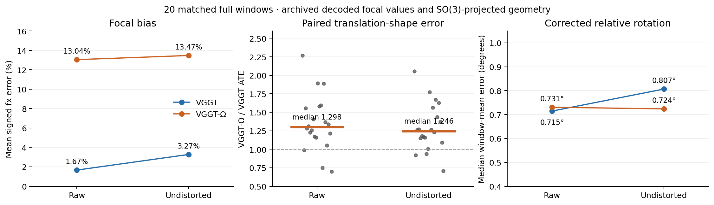
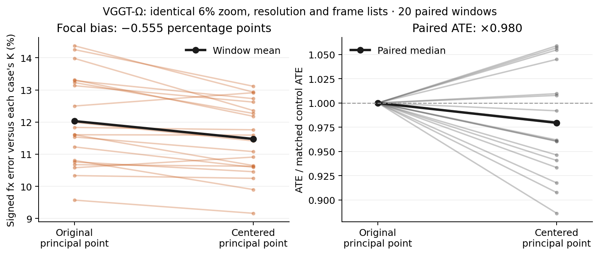
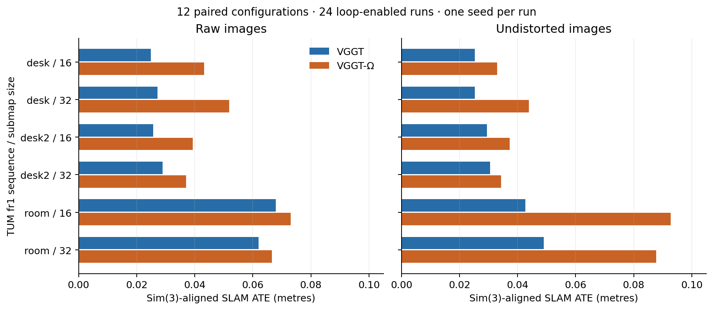

# VGGT-Ω-SLAM: experimental results and metric correction

This archive records an integration study on the public TUM RGB-D `freiburg1_desk`, `freiburg1_desk2`, and `freiburg1_room` sequences. The VGGT-Ω frontend overestimates focal length on these inputs, and its local translation-shape error remains higher after undistortion. The experiments narrow several explanations; they do not establish the training-time origin of the bias or a causal link from focal bias to translation error. These are results for this setup, without a state-of-the-art or general benchmark claim.

**中文简摘要：** 在这三条 TUM fr1 序列上，去畸变后 VGGT-Ω 仍高估焦距约 13.5%，子图平移形状误差约为 VGGT 的 1.25 倍。主点、输入分辨率和数值精度的后续实验没有消除主体偏差；具体根因仍未确定。历史旋转比较已更正，不能再引用“Ω 的相对旋转好一倍”。

“VGGT-Ω-SLAM” names this integration. “VGGT” and “VGGT-Ω” in the tables identify the two frontends used with the SLAM pipeline.

## Scope and definitions

The local comparison uses exactly **20 matched full windows**: 3 desk, 6 desk2, and 11 room windows, each with 17 frames (16 new keyframes and one overlap frame). Three shorter tail windows are retained for replay and excluded from these summaries. An additional 27 sparse windows cover 3 sequences × 3 frame counts (8/16/32) × 3 sampling grids. The frame lists are published in [frame_manifest.json](../results/frame_manifest.json).

Local ATE is camera-centre RMSE after a per-window Sim(3) alignment with scale. ATE/path divides this RMSE by the associated ground-truth path length. Backend ratios are computed for each matched window first, then summarized by their median; they are not ratios of separately pooled medians. Relative rotation is the mean adjacent-frame error within each window, followed by a median across windows. Ground truth is associated to each predicted frame within 0.01 seconds.

Signed focal bias is `(mean predicted fx / processed image width) / (true fx / source image width) - 1`, using the **correct K for each input condition**. Source images are 640 × 480; the original frontend inputs are VGGT 518 × 392 and VGGT-Ω 592 × 448. Vertical focal bias is evaluated analogously. The two loaders use slightly different horizontal and vertical resize factors.

Adjacent windows share a frame and scenes, so the 20 windows are dependent observations. Archived Wilcoxon p-values do not establish independent-sequence evidence. Whole-SLAM comparisons have one run per configuration, with seed 0 and loop closures enabled.

## Undistortion and local geometry

The following table uses the archived decoded focal values and the **SO(3)-projected geometry** under the archive's `proj` fields. The unprojected top-level geometry is retained for provenance and is superseded.

| Quantity | Raw images | Undistorted images |
|---|---:|---:|
| VGGT-Ω signed fx bias, mean over 20 windows | +13.040% | +13.469% |
| VGGT signed fx bias, same convention | +1.666% | +3.275% |
| Median paired VGGT-Ω / VGGT ATE ratio | 1.298 | 1.246 |
| Windows where VGGT-Ω has higher ATE, projected geometry | 17/20 | 17/20 |
| VGGT relative rotation, median window mean | 0.715° | 0.807° |
| VGGT-Ω relative rotation, same convention | 0.731° | 0.724° |

The corresponding **historical unprojected** ATE ratios were 1.294 and 1.246, with 17/20 and 16/20 windows worse for VGGT-Ω. Projection changes a close ordering in one undistorted window. Reporting the older 16/20 count alongside corrected metrics would mix conventions.



The predefined decision rule classifies distortion as explaining the gap only if VGGT-Ω's undistorted focal bias is below 5% and its paired ATE ratio is at most 1.05 on both desk and desk2. A bias above 8%, or ratios at least 1.2 on both sequences, selects “does not explain”; other outcomes are “partial.” The focal-bias branch selects **does not explain** here. The same decision holds after the rotation correction. This is a decision about the tested explanation on these sequences, not proof of a different root cause.

Undistortion changes the true focal length by ×1.057 horizontally and also changes the boundary content, principal point, and interpolation. Predicted focal length follows this increase while retaining most of the relative bias. In whole SLAM it additionally changes keyframes, partitions, and some accepted loop pairs. Consequently, raw-to-undistorted ATE changes cannot all be attributed to removal of lens distortion.

Sources: [full local metrics and rule](../results/undistortion/local_metrics.json), [calibration and remap verification](../results/undistortion/calibration.json).

## The rotation correction

VGGT's saved decoded bf16 rotation blocks are not exactly orthogonal. In the raw full-window archive, their maximum `||RRᵀ - I||` is approximately 0.017. Applying the trace/acos formula directly clipped **155 of 317** valid adjacent pairs to exactly zero, while other pairs acquired false angular error. The earlier apparent approximately twofold relative-rotation advantage for VGGT-Ω is invalid.

Projection of each rotation to SO(3) before composition gives the raw-image medians **0.715° for VGGT and 0.731° for VGGT-Ω**. The evidence supports similar adjacent-frame rotation accuracy on these inputs. It does not establish equality of every rotation metric, or resolve the consistency between orientation and translation estimates.

There are four metric conventions in this release:

| Convention | Location and interpretation |
|---|---|
| `legacy_unprojected_v0` | [front_end_legacy.json](../results/front_end_legacy.json) and the top-level geometry in `local_metrics.json`. Retained historical values. **Do not reuse their rotation claims.** |
| Archived matrix projection | Nested `proj` fields and `decision.robustness_rotations_projected_to_SO3` in `local_metrics.json`. Polar projection of saved rotation matrices; translation columns preserved. Focal values still come from the original decoded intrinsics. |
| `fp64_pose_decode_v1` | [intervention_results.json](../results/focal_cause/intervention_results.json) and [evidence_intervention_pairs.json](../results/focal_cause/evidence_intervention_pairs.json). Normalized stored quaternions and FoV decoded in float64. VGGT focal values can differ slightly from its original bf16-decoded intrinsics. |
| `so3_float64_v1` | Current [why_utils.py](../vos/why_utils.py). Projects individual input rotations in float64, preserves translation columns, constructs centres with the projected rotation, and evaluates angles with a stable atan2 formula. New `trajectory_metrics` outputs carry `geometry_metric_version`. |

The current helper corrects evaluation; it does not modify inference or previously saved SLAM trajectories. Running updated tools can therefore produce corrected values that differ from historical top-level fields. Do not combine legacy, projected, and quaternion-redecoded numbers without naming the convention. Tests in [test_geometry_precision.py](../tests/test_geometry_precision.py) cover real errors previously clipped to zero, false errors from contraction, proper-rotation projection, camera centres, and small angles.

## Controlled focal probes

These are exploratory mechanism checks on the same public windows. The archived [design](../results/focal_cause/intervention_design.json) fixes the conditions and the six-window subset (two windows per sequence). All **104** forward entries completed; the six baseline verifications reproduce the stored pose encoding exactly. The depth head is skipped for the camera-only probes after strict checkpoint loading.

| Condition | Windows | Mean fx bias | Median paired ATE / matched cached VGGT-Ω ATE |
|---|---:|---:|---:|
| Cached undistorted VGGT-Ω | 20 | +13.469% | 1.0000 |
| 6% zoom, original principal point | 20 | +12.030% | 1.0123 |
| 6% zoom, centered principal point | 20 | +11.475% | 0.9861 |
| Input 512 × 384 | 20 | +14.917% | 1.0672 |
| Input 640 × 480 | 20 | +12.834% | 1.0433 |
| fp32 condition | 6 | +13.945% | 0.9977 |
| Centered 25% zoom | 6 | +10.665% | 0.9520 |
| Centered 50% zoom | 6 | +10.033% | 0.9204 |

Rows with six windows compare against their own six matched cached baselines, whose mean focal bias is +13.966%; they must not be compared as if they sampled the same 20-window distribution.

The cleanest principal-point comparison is **centered 6% zoom versus uncentered 6% zoom**, not versus the unzoomed baseline. Across the same 20 windows, centering reduces mean fx bias by **0.555 percentage points** (+12.030% → +11.475%) and gives a paired median ATE ratio of **0.9796**; ATE improves in 14/20 windows. Centering moves the visible boundary as well. This effect leaves most of the focal bias intact.



The fp32 focal change is only **−0.0206 percentage points** on the six matched windows. Resolution changes also leave the focal bias positive. Increasing the centered zoom from 6% to 25%/50% reduces mean fractional bias further, but changes visible content and retains approximately +10–11% bias. None of these interventions uniquely identifies a learned focal prior or the training mechanism.

Cached sparse-window estimates also depend on context: VGGT-Ω's mean focal bias for N=8/16/32 is **+19.95/+17.75/+16.03%** on raw images and **+18.56/+16.76/+15.23%** after undistortion. Changing N changes the frame set and spacing, so these observations do not isolate a frame-count effect. Across the 20 local windows, larger focal differences do not show a positive correlation with larger backend ATE differences. A focal-input or known-K intervention that establishes causality for translation has not been performed.

Full per-window values, timings, statuses, and paired controls are in [intervention_results.json](../results/focal_cause/intervention_results.json), [intervention_forward.json](../results/focal_cause/intervention_forward.json), and the independent `evidence_*.json` files listed below.

## Whole-SLAM comparison

These **12 paired configurations** comprise 24 runs: raw/undistorted × submap size 16/32 × three sequences × two frontends. Values are saved-trajectory Sim(3) ATE in metres, with loop closures enabled. Each configuration was run once; the table describes this experiment, not a repeat-seed confidence estimate.

| TUM fr1 sequence | Submap size | Raw VGGT | Raw VGGT-Ω | Undistorted VGGT | Undistorted VGGT-Ω |
|---|---:|---:|---:|---:|---:|
| desk | 16 | 0.02490 | 0.04318 | 0.02529 | 0.03295 |
| desk | 32 | 0.02720 | 0.05188 | 0.02522 | 0.04390 |
| desk2 | 16 | 0.02563 | 0.03937 | 0.02950 | 0.03730 |
| desk2 | 32 | 0.02892 | 0.03707 | 0.03049 | 0.03428 |
| room | 16 | 0.06796 | 0.07310 | 0.04270 | 0.09272 |
| room | 32 | 0.06192 | 0.06657 | 0.04898 | 0.08770 |

VGGT-Ω has higher ATE in all 12 paired configurations. Within each image condition, the two frontends use matching keyframe selections and partitions. Raw-to-undistorted comparisons change those selections and some loops; room's larger whole-SLAM change cannot be assigned solely to its small local-window change.



The [full SLAM summary](../results/undistortion/slam_summary.json) preserves unrounded values, timing, peak memory, frame/update counts, loop candidates, accepted pairs, and checks on keyframe/partition changes. Its saved trajectory ATE is distinct from camera-only focal-probe ATE.

## Published files and replay

[artifact_index.json](../results/artifact_index.json) records the source artifact, purpose, metric convention, and source SHA-256 for each copied result. Host paths are replaced with relative archive locations or symbolic placeholders; numerical values are preserved.

The later [system adaptation experiments](ADAPTATION.md) test confidence and
graph-noise policies, submap context, and a fixed keyframe-density/submap-size
grid. Their `adaptation_*.json` files carry their own designs, frozen selections,
metric definitions, and source hashes. They preserve the earlier matched-model
comparison above; a frontend setting with different keyframes has different
evaluation support and inference cost.

| File under `results/` | Purpose |
|---|---|
| `summary.json` | Compact cross-experiment summary, explicit geometry conventions, controlled probes, and all 12 SLAM pairs. |
| `artifact_index.json` | Per-file purpose, source provenance, metric convention, and path-sanitization policy. |
| `frame_manifest.json` | Exact filenames for all 51 A/R/B jobs, including short tails, plus all four original backend/loop partitions per sequence. No dataset access is needed to recover the window definitions. |
| `undistortion/local_metrics.json` | Full raw/undistorted local and sparse metrics, predefined rule, per-window values, and archived `proj` correction. |
| `undistortion/slam_summary.json` | Full 24-run SLAM comparison and structural checks. |
| `undistortion/calibration.json` | Original/new K, distortion coefficients, remap checks, and public-sequence counts. |
| `front_end_legacy.json` | Original front-end/overlap audit for provenance; its unprojected rotation comparisons are superseded. |
| `focal_cause/intervention_results.json` | Full controlled-probe summaries, direct pairs, all per-window metrics, and baseline checks. |
| `focal_cause/intervention_design.json` | Conditions, K, resolution, exact window names, subset selection, and limitations. |
| `focal_cause/intervention_forward.json` | Status, time and memory of all 104 completed forward calls. |
| `focal_cause/fov_sweep_design.json` | Hypotheses recorded before the zoom follow-up, plus its limitations. |
| `focal_cause/evidence_cached_geometry.json` | Independent SO(3) audit, GT interpolation, axis slopes, and diagnostic coordinate stretches. A post-hoc coordinate stretch is not a model intervention. |
| `focal_cause/evidence_focal_regimes.json` | Context/frame-set-dependent focal estimates and same-first-frame checks. |
| `focal_cause/evidence_intervention_pairs.json` | Independent 20-window principal-point pairing using each case's true K. |
| `focal_cause/evidence_principal_point.json` | Geometric ray/FoV calculation of the principal-point approximation; not a network intervention. |
| `adaptation_backend.json` | Exact CPU replay gates, confidence/noise development results, and frozen backend validation. |
| `adaptation_context.json` | Same-frame context-shift design and all per-window results for both models. |
| `adaptation_frontend.json` | Six-setting development grid, frozen validation, resource failures, and separate memory-only retry evidence. |
| `render_figures.py` and `figures/` | Rebuilds the three data-only figures; PNG and SVG outputs contain no scene imagery. |

The archive contains no source RGB/depth images, private office sequences, weights, clouds, or bulk prediction NPZ files. Re-running inference requires obtaining the public datasets and checkpoints separately, following the repository setup instructions. The manifest resolves frame names relative to each sequence's `rgb/` directory.

Figures can be regenerated from published JSON alone:

```bash
python results/render_figures.py
```
